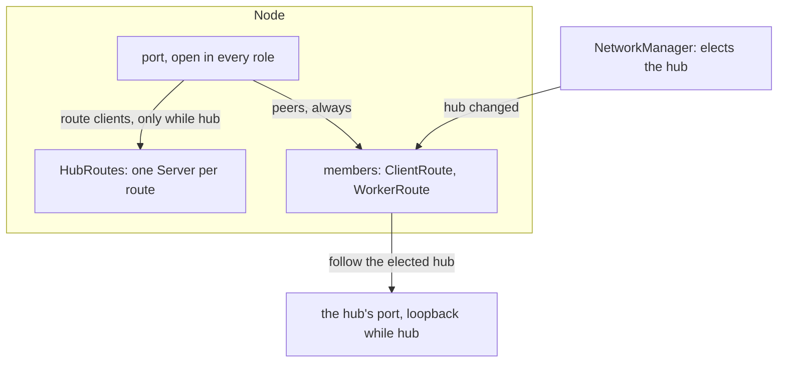
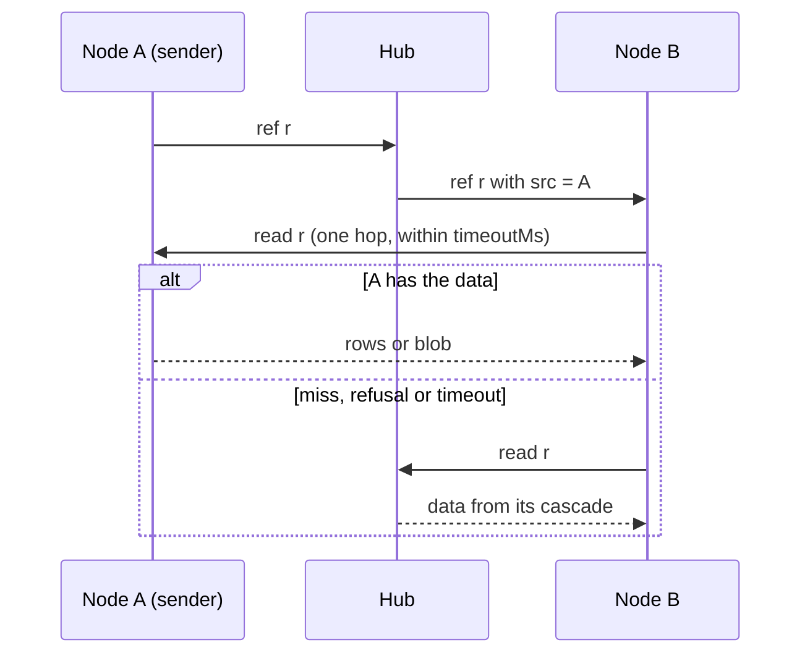

<!--
@license
Copyright (c) rljson

Use of this source code is governed by terms that can be
found in the LICENSE file in the root of this package.
-->

# `Node` becomes the base of every node, and data comes from its sender

## Motivation

- A node of an rljson network does the same work on every machine: find the
  others, take part in the hub election, serve as hub when elected, and sync
  each of its routes with whoever is hub.
- `Node` covered one route with its data in memory, ran a `Server` only
  while hub and handed the hub's agent the `Server` itself. An application
  with several routes, stores on disk or routes in their own processes had
  to build its own node beside it.
- The hub also served every byte: a client pulled announced data from the
  hub, and the hub pulled it from the client that had it.
- The goal: one `Node` that every application builds on, and data that comes
  straight from the node that has it, with the hub as the safe fallback.

## Strategy

- `Node` owns the port, the network and a hub service for every route. The
  application brings its routes as members; following the hub is the node's
  job.
- The hub names the node each relayed ref came from (`src`). A client reads
  that ref's data there first: bounded, read-only, one hop, the hub as
  fallback, whose answer is returned unchanged.
- Both parts are tested on real Socket.IO meshes, not on mocks.
- The old single-route API is removed instead of kept beside the new one.

## Implementation 1: One port and a hub service for every route

- **One port in every role** (`createPortTransport`): the target of the
  network's probes; it takes route clients only while this node is hub and
  peers always. A route client at a node that is not hub gets a connect
  error and retries, instead of syncing with nobody.
- **The handshake says who connects:** `treeKeys` names the route,
  `peerRead` marks a peer, which never becomes a client of the hub.
- **`HubRoutes`** runs one `Server` per route, with its own stores and
  options, created when the route's first client arrives.
- **The hub knows who is connected:** every client says hello with its node
  id (`ClientOptions.nodeId`; the hub also asks, `who`). The hub self-check
  counts other nodes only, as its own members connect over loopback.

## Implementation 2: Members that follow the hub

- **`RouteMember`** is one route of this node. `ClientRoute` runs a `Client`
  and its agent in process. `WorkerRoute` runs the route in a worker process
  and talks to it over `ChannelSocket`, an io `Socket` over a message
  channel. Peers read the worker's stores over that channel too;
  `serveWorkerRoute` is the worker's side.
- **Moving with the hub:** on a role, hub or topology change, after a settle
  time (`reconnectDelayMs`) and one move at a time, every member restarts on
  the elected hub. A failed start is retried (`retryMs`), a drift check
  (`driftCheckMs`) catches a missed event, a move to a hub that moved on is
  aborted. `ready` comes once every member runs.
- **A node alone** acts as its own hub after `aloneHubMs` (12 s), and yields
  to the first peer or elected hub.
- **At runtime:** `addMember` and `removeMember` add and drop routes;
  `closePort` and `openPort` take a node off the network the way a crash
  looks from outside, for tests of a hub that goes down.
- **Breaking:** the single-route API is gone (`route`, `serverOptions`,
  `clientOptions`, `createHubTransport`, `createAgent`, `restartAgent`,
  `node.server`, `node.client`, `node.io`, `node.bs` and more).

## Implementation 3: Peer reads with the hub as fallback

- **The hub names the source.** `Server` sets `src` on every ref it relays
  from a client that said hello, and removes a `src` a sender set itself.
- **The client remembers it.** With `ClientOptions.peerReads`, `PeerReads`
  keeps the sources of recent refs and a small pool of peer connections;
  `client.peerReads.stats` counts hits, misses and failures.
- **Peers sit inside the hub's slot.** `PeerFirstIo` and `PeerFirstBs` wrap
  the hub's Io and Bs: row and blob reads ask the peers first, then the hub.
  A failing peer stays invisible to `IoMulti`, so it can only make a read
  faster, never turn a "not found" into an error.
- **Bounded:** a read waits `timeoutMs` (1 s) for the peers. A peer that
  times out, refuses or breaks off is skipped for `downMs`; a blob stream
  that loses its peer finishes from the hub at the same offset.
- **`PeerReadServer`** answers from a node's local stores only, read-only,
  under backpressure and a serving gate. A peer never forwards a question,
  so nothing cascades.
- **In `Node`:** `config.peerReads` and `deps.connectPeer` switch it on (off
  by default). A source becomes an address through `resolvePeerAddress`.
  With an older hub, which sets no `src`, every read stays with the hub.

## Implementation 4: Hardened on running nodes

- **A worker that exits no longer takes its node down.** Its `ChannelSocket`
  sent a close into the closed channel, which a process channel raises as an
  unhandled `'error'` event. It sends nothing into a closed channel now, and
  a send that fails ends the socket.
- **`ready` also comes** when a retry starts the last missing member, and a
  member added during a move starts once, not a second time on the same hub.
- **`connectHub` is optional**, needed only by members that connect through
  the node. A worker reports what it served: `serveWorkerRoute(…).stats`.

## Implementation 5: Tests on real Socket.IO

- **`test/node-mesh.spec.ts`:** `Node`s read from the sender while the hub
  serves none of it, follow a hub that moves, fall back to the hub once a
  sender is gone, and serve peers from a worker route.
- **`test/peer-reads-mesh.spec.ts`:** a hub and up to six clients with own
  ports; senders reachable, refusing, silent, unknown or without the data;
  large blobs; a sender leaving mid-stream; all nodes writing at once.
- A control run with peer reads off, where the hub serves every read, shows
  that the count is right. Every new part has its own spec as well.

## Dependency updates

- **`@rljson/rljson`** adds `ConnectorPayload.src`, the node a relayed ref
  came from. The hub sets it, a sender never does, and payloads without it
  stay valid, so older nodes keep working.
- **`@rljson/network`** adds `NetworkManager.resolvePeerAddress(nodeId)`: a
  known peer's `ip:port`, or null for the node itself, an unknown node or one
  the probes found unreachable. `Node` uses it to reach a ref's source.

## Open Points

- A client asks only the source of a recent ref (`sourceTtlMs`, 60 s).
  Asking further peers it is already connected to, to spread the load, is
  not done yet. Until then the source's serving gate bounds its load, and a
  ref whose source has no known address goes to the hub.
- Peer reads are off by default; whether they become the default is open.
