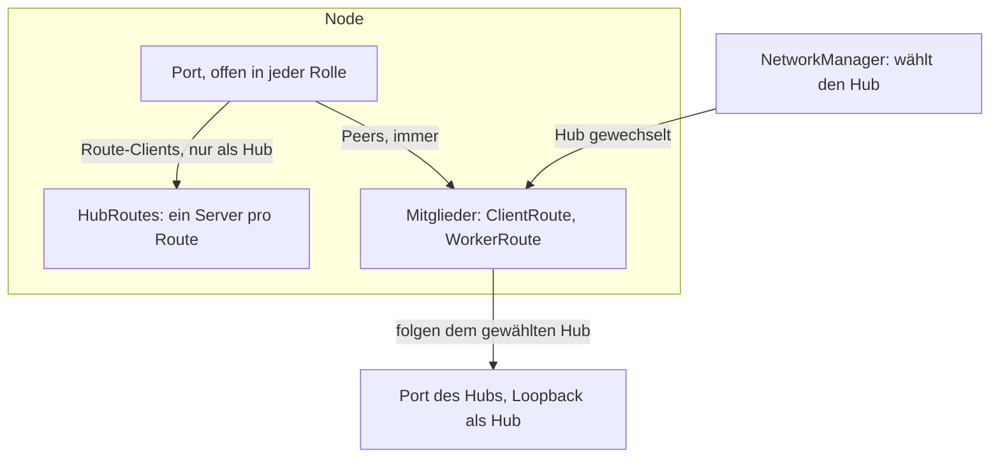
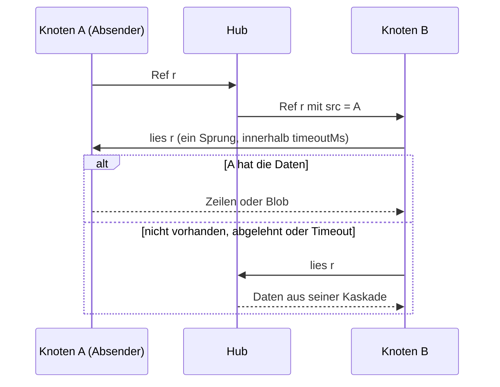

<!--
@license
Copyright (c) rljson

Use of this source code is governed by terms that can be
found in the LICENSE file in the root of this package.
-->

# `Node` wird die Basis jedes Knotens, und Daten kommen vom Absender

## Motivation

- Ein Knoten eines rljson-Netzwerks tut auf jeder Maschine dasselbe: die
  anderen finden, an der Hub-Wahl teilnehmen, als Hub dienen, wenn er gewählt
  ist, und jede seiner Routen mit dem gerade gewählten Hub abgleichen.
- `Node` deckte eine Route mit Daten im Speicher ab, betrieb einen `Server`
  nur als Hub und gab dem Agenten des Hubs den `Server` selbst. Eine
  Anwendung mit mehreren Routen, Speichern auf der Platte oder Routen in
  eigenen Prozessen musste daneben ihren eigenen Knoten bauen.
- Außerdem lieferte der Hub jedes Byte: Ein Client holte angekündigte Daten
  vom Hub, und der Hub holte sie vom Client, der sie hatte.
- Das Ziel: ein `Node`, auf dem jede Anwendung aufbaut, und Daten, die direkt
  vom Knoten kommen, der sie hat, mit dem Hub als sicherem Rückfall.

## Strategie

- `Node` besitzt den Port, das Netzwerk und einen Hub-Dienst für jede Route.
  Die Anwendung bringt ihre Routen als Mitglieder mit; dem Hub zu folgen, ist
  Aufgabe des Knotens.
- Der Hub nennt zu jeder weitergeleiteten Ref den Knoten, von dem sie kam
  (`src`). Ein Client liest die Daten dieser Ref zuerst dort: begrenzt, nur
  lesend, ein Sprung, mit dem Hub als Rückfall, dessen Antwort unverändert
  zurückkommt.
- Beide Teile sind auf echten Socket.IO-Netzen getestet, nicht mit Mocks.
- Die alte Ein-Routen-API ist entfernt, statt neben der neuen zu bleiben.

## Realisierung 1: Ein Port und ein Hub-Dienst für jede Route

- **Ein Port in jeder Rolle** (`createPortTransport`): Ziel der Proben des
  Netzwerks; er nimmt Route-Clients nur an, solange dieser Knoten Hub ist,
  Peers immer. Ein Route-Client an einem Knoten, der nicht Hub ist, bekommt
  einen Verbindungsfehler und versucht es erneut, statt mit niemandem
  abzugleichen.
- **Der Handshake sagt, wer sich verbindet:** `treeKeys` nennt die Route,
  `peerRead` markiert einen Peer, der nie Client des Hubs wird.
- **`HubRoutes`** betreibt einen `Server` pro Route, mit eigenen Speichern
  und Optionen, angelegt, sobald der erste Client der Route kommt.
- **Der Hub weiß, wer verbunden ist:** Jeder Client grüßt mit seiner
  Knoten-ID (`ClientOptions.nodeId`; der Hub fragt auch, `who`). Der
  Selbsttest des Hubs zählt nur andere Knoten, denn seine eigenen Mitglieder
  verbinden sich über Loopback.

## Realisierung 2: Mitglieder, die dem Hub folgen

- **`RouteMember`** ist eine Route dieses Knotens. `ClientRoute` betreibt
  einen `Client` mit seinem Agenten im Prozess. `WorkerRoute` betreibt die
  Route in einem Worker-Prozess und spricht mit ihm über `ChannelSocket`,
  einen io-`Socket` über einen Nachrichtenkanal. Auch Peers lesen die
  Speicher des Workers über diesen Kanal; `serveWorkerRoute` ist die Seite
  des Workers.
- **Mit dem Hub umziehen:** Bei einem Wechsel von Rolle, Hub oder Topologie
  startet jedes Mitglied nach einer Beruhigungszeit (`reconnectDelayMs`) und
  ein Umzug nach dem anderen neu am gewählten Hub. Ein gescheiterter Start
  wird wiederholt (`retryMs`), eine Drift-Prüfung (`driftCheckMs`) fängt ein
  verpasstes Ereignis ab, ein Umzug zu einem schon weitergezogenen Hub wird
  abgebrochen. `ready` kommt, sobald jedes Mitglied läuft.
- **Ein Knoten allein** wird nach `aloneHubMs` (12 s) sein eigener Hub und
  weicht dem ersten Peer oder gewählten Hub.
- **Zur Laufzeit:** `addMember` und `removeMember` fügen Routen hinzu und
  entfernen sie; `closePort` und `openPort` nehmen einen Knoten so vom Netz,
  wie ein Absturz von außen aussieht, für Tests eines ausfallenden Hubs.
- **Breaking:** Die Ein-Routen-API ist weg (`route`, `serverOptions`,
  `clientOptions`, `createHubTransport`, `createAgent`, `restartAgent`,
  `node.server`, `node.client`, `node.io`, `node.bs` und mehr).

## Realisierung 3: Peer-Reads mit dem Hub als Rückfall

- **Der Hub nennt die Quelle.** `Server` setzt `src` auf jede Ref, die er
  von einem Client weiterleitet, der gegrüßt hat, und entfernt ein `src`, das
  ein Absender selbst gesetzt hat.
- **Der Client merkt sie sich.** Mit `ClientOptions.peerReads` hält
  `PeerReads` die Quellen der letzten Refs und einen kleinen Pool von
  Peer-Verbindungen; `client.peerReads.stats` zählt Treffer, Fehlanzeigen und
  Fehler.
- **Peers sitzen im Platz des Hubs.** `PeerFirstIo` und `PeerFirstBs`
  umhüllen Io und Bs des Hubs: Zeilen- und Blob-Lesezugriffe fragen zuerst
  die Peers, dann den Hub. Ein scheiternder Peer bleibt für `IoMulti`
  unsichtbar; er kann einen Lesezugriff nur schneller machen und nie ein
  „nicht gefunden“ in einen Fehler verwandeln.
- **Begrenzt:** Ein Lesezugriff wartet `timeoutMs` (1 s) auf die Peers. Ein
  Peer, der nicht antwortet, ablehnt oder abbricht, wird für `downMs`
  übersprungen; ein Blob-Stream, der seinen Peer verliert, wird ab derselben
  Stelle vom Hub zu Ende gelesen.
- **`PeerReadServer`** antwortet nur aus den lokalen Speichern eines Knotens,
  nur lesend, mit Backpressure und einer Bedienschranke. Ein Peer reicht nie
  eine Frage weiter, also kaskadiert nichts.
- **In `Node`:** `config.peerReads` und `deps.connectPeer` schalten es ein
  (standardmäßig aus). Eine Quelle wird über `resolvePeerAddress` zur
  Adresse. Mit einem älteren Hub, der kein `src` setzt, bleibt jeder
  Lesezugriff beim Hub.

## Realisierung 4: Gehärtet an laufenden Knoten

- **Ein Worker, der endet, reißt seinen Knoten nicht mehr mit.** Sein
  `ChannelSocket` schickte ein Close in den geschlossenen Kanal, was ein
  Prozesskanal als unbehandeltes `'error'`-Ereignis meldet. Jetzt schickt er
  nichts mehr in einen geschlossenen Kanal, und ein scheiterndes Senden
  beendet den Socket.
- **`ready` kommt auch**, wenn eine Wiederholung das letzte fehlende Mitglied
  startet, und ein während eines Umzugs hinzugefügtes Mitglied startet nur
  einmal, nicht ein zweites Mal am selben Hub.
- **`connectHub` ist optional**, nötig nur für Mitglieder, die sich über den
  Knoten verbinden. Ein Worker meldet, was er bedient hat:
  `serveWorkerRoute(…).stats`.

## Realisierung 5: Tests auf echtem Socket.IO

- **`test/node-mesh.spec.ts`:** `Node`s lesen vom Absender, während der Hub
  nichts davon liefert, folgen einem umziehenden Hub, fallen auf den Hub
  zurück, wenn ein Absender weg ist, und bedienen Peers aus einer
  Worker-Route.
- **`test/peer-reads-mesh.spec.ts`:** ein Hub und bis zu sechs Clients mit
  eigenen Ports; Absender erreichbar, ablehnend, stumm, unbekannt oder ohne
  die Daten; große Blobs; ein Absender, der mitten im Stream geht; alle
  Knoten schreiben gleichzeitig.
- Ein Kontrolllauf mit ausgeschalteten Peer-Reads, in dem der Hub jeden
  Lesezugriff liefert, zeigt, dass die Zählung stimmt. Jeder neue Teil hat
  zudem eine eigene Spec.

## Aktualisierte Abhängigkeiten

- **`@rljson/rljson`** ergänzt `ConnectorPayload.src`, den Knoten, von dem
  eine weitergeleitete Ref kam. Der Hub setzt es, ein Absender nie, und
  Payloads ohne das Feld bleiben gültig, also arbeiten ältere Knoten weiter.
- **`@rljson/network`** ergänzt `NetworkManager.resolvePeerAddress(nodeId)`:
  `ip:port` eines bekannten Peers, oder null für den Knoten selbst, einen
  unbekannten Knoten oder einen, den die Proben unerreichbar fanden. `Node`
  erreicht damit die Quelle einer Ref.

## Offene Punkte

- Ein Client fragt nur die Quelle einer jungen Ref (`sourceTtlMs`, 60 s).
  Weitere Peers zu fragen, mit denen er schon verbunden ist, um die Last zu
  verteilen, ist noch nicht umgesetzt. Bis dahin begrenzt die Bedienschranke
  der Quelle ihre Last, und eine Ref, deren Quelle keine bekannte Adresse
  hat, geht an den Hub.
- Peer-Reads sind standardmäßig aus; ob sie Standard werden, ist offen.
